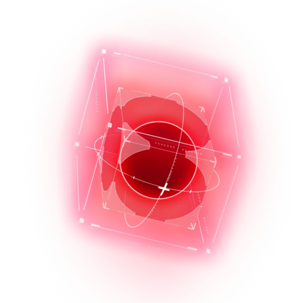

  

<h1 align="center">Dominik</h1>

  Team builds, game data and planning tools for <b>Punishing: Gray Raven</b>

  <a href="https://dominiko.pages.dev/"><b>Open the site</b></a>
  ·
  <a href="https://dominiko.pages.dev/calculator">BC Calculator</a>
  ·
  <a href="https://dominiko.pages.dev/timeline">Meta Timeline</a>
  ·
  <a href="https://dominiko.pages.dev/contact">Contact</a>
  ·
  <a href="https://ko-fi.com/ofcrazy">Support on Ko-fi</a>

## About

Dominik is a fan-made website for Punishing: Gray Raven players. It brings team compositions, character builds and game data such as memories, weapons and C.U.B.s together in one place, along with tools for planning your pulls.

## Purpose

Information about the game is spread across guides, videos and spreadsheets. Dominik answers the common questions in one place:

- Which team should I run for this energy type or effect?
- Which memories, weapon and resonances does each character need?
- How many Black Cards will I have by a future patch, and can I afford the next banner?
- How long do characters usually stay in the meta, and who may be replaced next?

## How to use the site

The site works on desktop and phones, with nothing to install and no account to create.

To jump straight to something, use the search box in the menu. It finds constructs, teams, memories, weapons, resonances and C.U.B.s, and it shows the closest match first.

### Find a team

1. On the [home page](https://dominiko.pages.dev/), pick an energy type or a derivative effect.
2. Choose a team from the list at the top of the page.
3. Read each character's card, which shows their memories, weapon harmony and resonances.
4. Hover over an icon to see its name, or tap it on a phone.

To share a build, copy the page address, which always points to the team on screen. You can also use **Export image** to save the build as a picture.

### Browse the game data

| Page | What you will find |
| --- | --- |
| [Constructs](https://dominiko.pages.dev/constructs) | Every construct with a build, with filters for element, class, rank and effect. Each one links to its builds and skills. |
| [Memories](https://dominiko.pages.dev/assets/memories) | A table of memories you can sort by column. |
| [Weapons](https://dominiko.pages.dev/assets/weapons) | A table of weapons you can sort by column. |
| [Weapon Resonance](https://dominiko.pages.dev/assets/resonances) | A table of weapon resonances you can sort by column. |
| [C.U.B.s](https://dominiko.pages.dev/assets/cubs) | A table of C.U.B.s you can sort by column. |

### Plan your pulls

The [BC Calculator](https://dominiko.pages.dev/calculator) has two tabs:

- **Planner:** enter your starting balance and see your Black Cards across upcoming patches. It also adds up the cost of the passes you pick, with estimated real-money prices.
- **Pull chance:** choose a banner and a number of pulls to see your odds, including how often pity triggers.

It uses the same math as the [Tickets Income spreadsheet](https://docs.google.com/spreadsheets/d/1h1fmMIC0zn_XPgAP8iVCEoNGgFV_DQ2-S44JNqErXFw/edit) by Crazy117 and Sidewayz.

### Follow the meta

The [Meta Timeline](https://dominiko.pages.dev/timeline) shows how long each S-Rank frame held its place before a newer one replaced it.

- **Views:** group the timeline by class and element, or by class and effect.
- **Rankings:** see who lasted the longest and the shortest, who has gone longest without being replaced, and the average time until replacement for each class.
- **Replacement watch:** compare each current frame's time in place with the average for its class. This is a guide, not a release date.
- **Filters:** show a single element or effect, or only the frames still in place.
- **Free tag:** marks frames you can get without pulling.

Dates follow the Chinese server, which gets each frame first, so Global release dates are not considered. Collabs and uniframes are not counted.

## Useful links

- [Dominik](https://dominiko.pages.dev/): the live site
- [Tickets Income spreadsheet](https://docs.google.com/spreadsheets/d/1h1fmMIC0zn_XPgAP8iVCEoNGgFV_DQ2-S44JNqErXFw/edit): patch income for the calculator and dates for the timeline
- [Huaxu wiki](https://huaxu.app/na/wiki): game data and art
- [GRAY RAVENS wiki](https://grayravens.com/wiki): skills and patch history
- [Chinese wiki](https://wiki.biligame.com/zspms/%E6%88%98%E5%8F%8C%E5%A4%A7%E4%BA%8B%E8%AE%B0): the Chinese server's history, used for the timeline
- [Spider 2B on YouTube](https://www.youtube.com/@Spider2B): guides behind several builds

## Feedback

Found a wrong build, or have a question or suggestion? Message **crazy117** on Discord. You can also find the details on the [Contact page](https://dominiko.pages.dev/contact).

If the site helps you, you can [support it on Ko-fi](https://ko-fi.com/ofcrazy).

## Credits

- **[blacknovatech](https://huaxu.app/na/wiki)**, creator of Huaxu, for the assets ([support on Ko-fi](https://ko-fi.com/blacknova))
- **sidewayz.**, for helping with the site's overall design
- **[GRAY RAVENS wiki](https://grayravens.com/wiki)**, for skills and the patch history
- **[Spider 2B](https://www.youtube.com/@Spider2B)**, for the guides behind several builds

## Disclaimer

Dominik is an unofficial fan project and is not affiliated with Kuro Games. Punishing: Gray Raven and its characters and art belong to their respective owners.
